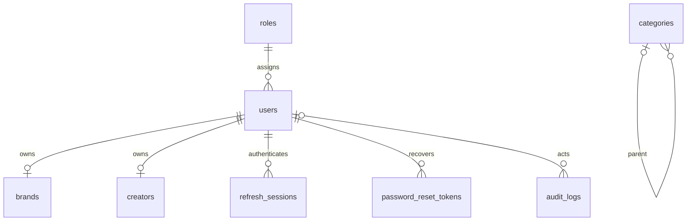
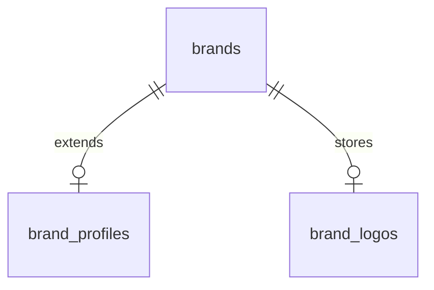
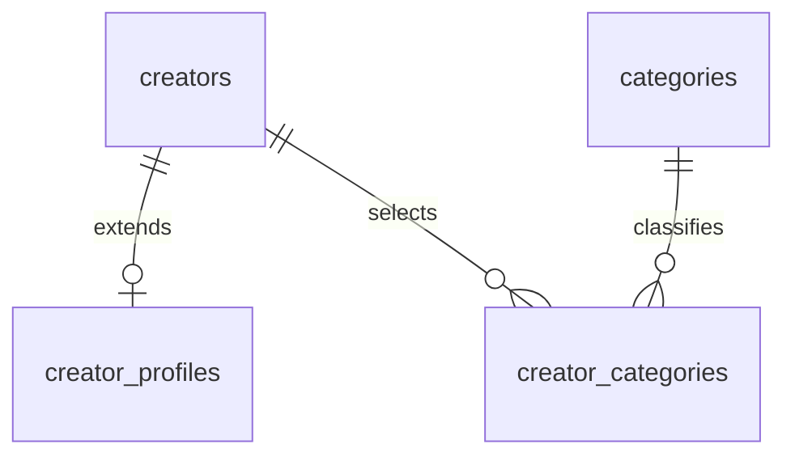

# Architecture and database reference

`React -> REST route -> validation/auth/RBAC -> controller -> service -> repository -> parameterized MySQL stored procedure`

The implemented health service checks DB connectivity directly; business persistence will use stored procedures. Controllers stay thin. Services enforce application policy; stored procedures enforce integrity and transactional multi-record workflows. Store timestamps in UTC. Return sanitized DTOs rather than raw credential-bearing database rows.

## Foundation tables (implemented SQL)

Platforms and content_types are standalone catalogs in Module 1. Role/profile consistency is enforced by the transactional account-creation workflow in Module 2. Never store plaintext refresh or reset tokens. No default admin credentials are seeded. Audit metadata must exclude secrets and unnecessary personal data.

## Current database schema

The initial hand-drawn relationship map has been superseded by the schema-backed [MySQL ERD](ERD.md), generated from `information_schema` after migrations. Regenerate it with `npm.cmd run docs:erd -w backend`. It currently describes the configured database's tables, columns, foreign keys and views; migrations and procedures remain the source of truth for constraints and workflow behavior.

## Workflow boundaries

See the module guides for complete state graphs and endpoint-specific policy. At a high level, identity is role-based; campaign preparation, approval and lifecycle are in Module 06; discovery, eligibility, applications and allocation are in Module 07; content history, review and completion are in Module 08; Test Mode funding, balanced wallet postings, commission, releases and refunds are in Module 09; reviews, messages and notifications are in Module 10; analytics and ledger reports are in Module 11.

Module 05 Task 4 adds `sp_get_creator_dashboard`: a read-only consistent snapshot of the authenticated Creator's profile, categories, social accounts, file metadata and catalog availability. Service-derived completeness is distinct from admin-controlled verification. Audience counts retain manual provenance, null/zero semantics and an overlap caveat. No binary verification files or invented campaign/payment metrics enter the dashboard DTO.

Module 05 Task 3 implements `creators -> creator_assets`. Files use private bounded MySQL blobs; generated photo-slot uniqueness enforces one photo, owner-locked transactions enforce other quotas. Replacements keep the UUID and increment revisions; remove/add changes UUID. Metadata excludes binary content and original filenames. Creator photo reads use authenticated blob previews. Active Super Admin can read only verification evidence through dedicated routes; evidence downloads are audited. Image metadata is stripped by re-encoding; restricted PDFs are copied into a fresh document. All downloads are no-store/nosniff with generated filenames and sandbox CSP. No public static upload directory exists.

Module 05 Task 2 implements `creators -> creator_social_accounts <- platforms`. The creator/platform pair is unique; owned rows cascade on creator removal. Manual nullable metrics have no provider verification claims. Social account revisions are independent of profile revisions. Writes and audit events commit together, with role/user/creator locks before catalog/account operations.

## Module boundaries and open policies

JWTs do not replace object ownership checks. Each role workspace enforces role, active-account and record ownership in the API and again in transactional database procedures where applicable. Sensitive mutations require the configured browser-origin policy and request-protection header. Financial postings and retained workflow history are immutable; corrections use explicit compensating workflows.

The implemented payment policy is selected local Test Mode: INR campaign principal, equal funded-principal Creator shares, 10% commission per share, explicit release after completion/latest content approvals, test wallets, and full refund only after cancellation and before Creator release. Bank transfers and automatic partial/post-release reversals are outside this workflow. Social account metrics are self-reported until an authorized provider is connected. Local private files use MySQL; production object storage and retention policies need deployment configuration. SMTP delivery and external webhook ingress also need deployment setup.

## Module 04 additions (implemented)

Brand extended contact/social/billing data is private to the authenticated owner. Profile and logo revisions are independent and monotonic. Company logos are validated/re-encoded WebP images stored in MySQL and downloaded only through an authenticated API. The original upload filename/metadata is not retained. Brand writes/audits commit atomically under user/brand row locks.

## Module 05 Task 1 additions (implemented)

Bio/location remain on creators for compatibility with Admin account detail. Languages/skills live in creator_profiles JSON; selected categories use foreign keys and a composite unique key. Full replacement saves check a monotonic revision and commit fields, category links and a privacy-conscious audit atomically. Shared catalog writes and Creator saves take locks in the same order. New category choices must be active with an active parent; existing unavailable choices can be retained or removed. Manual social profiles, private Creator assets and the role dashboard are implemented in later Module 05 tasks; provider sync remains unconfigured.

Module 06 Task 3 adds campaign_review_history and atomic review transitions. Shared role lock serializes decisions/submissions with campaign edits, schedule/file writes, catalog changes and account status operations. Revision checks prevent stale/duplicate actions. Submission and approval revalidate required saved content, active catalog entries/parents, coherent deliverables, private brief, ordered dates and future application deadline/start. Active owner is required for submission/approval. Rejection can still resolve a pending campaign with an inactive owner. Review history stores actors/statuses/reasons/revisions, not full content/file snapshots; returned drafts are mutable and admin details show the current saved version. Audit metadata omits reason and content. Admin access is restricted to submitted/history-bearing records and file reads are audited. Approval never publishes.

Module 06 Task 4 adds campaign_lifecycle_history and transactional publish/pause/resume/cancel, unused-draft deletion and server-time schedule reconciliation. Shared role/campaign locks serialize lifecycle with submission/decisions/content/catalog/account operations. Manual actions require revisions/reasons; schedule transitions are idempotent and record null-actor system events. The listening API runs a nonoverlapping 60-second clock with bounded 100-row batches and startup/downtime catch-up. APPROVED expires unpublished at application deadline/start; LIVE/PAUSED closes applications at deadline, then starts at campaign start. End dates do not fabricate content completion. Combined read-only history merges review/lifecycle events by revision. Only history-free DRAFT can be deleted with cascades plus retained audit. Cancellation is final and coordinates with application and financial workflows. Brand list supports bound status and literal title filters; Admin can inspect lifecycle metadata, cancel and refresh but cannot publish/pause/resume.

Module 07 Task 1 adds the SQL SECURITY INVOKER view creator_discoverable_campaigns and four allowlisted read procedures. Visibility requires LIVE, active Brand, open application window/future start, coherent saved details/active catalogs including category parents, and a brief. The same predicate protects list, detail and campaign-scoped binary reads independently of the minute clock. List/count and detail resultsets use read-only consistent snapshots. Structured JSON choice arrays avoid truncated aggregate strings; exact DECIMAL strings are retained. Read DTOs omit Brand contact/billing/review/actor data. Active authenticated Creators can access published brief/reference files only while discoverable; owner-only draft uploads remain unchanged. Filters bind title/Brand literal substring, platform, category including direct children, content type and currency. URL query state preserves browse filters/page across detail navigation. No applications, slot availability claims or per-Creator pay are fabricated.

Module 07 Task 2 adds campaign_applications (unique campaign/Creator; restrictive FKs), campaign_application_history and creator_campaign_eligibility view. The saved-data gate requires verified identity, nonempty bio/location/languages, exact/direct-parent-child active category match and at least one matching social platform. No follower/pay threshold or free-text requirement is fabricated. Apply serializes role/user/Creator/campaign locks and repeats current discovery/eligibility checks; pending application/history/audit commit atomically. Withdrawal locks the same campaign then application and checks revision plus PENDING/SHORTLISTED state, independently of campaign visibility. Withdrawn applications remain unique and cannot reapply. Tracking DTOs expose only the owner’s pitch/status/revision plus campaign title/company/current status, with history but no Brand contact/billing or Creator evidence. Applying does not reserve slots. Used campaign deletion now explicitly rejects applications and restrictive FKs reinforce retention. Task 3 extends the same lock discipline to Brand decisions and atomic allocation.

Module 07 Task 3 adds campaign_creator_allocations and campaign_applicant_review_windows. Brand-owned campaign/application reads use consistent snapshots; Creator profile projections omit contact/evidence and restrict assets to PHOTO/PORTFOLIO with audited campaign/application-scoped reads. Review window permits LIVE/PAUSED/APPLICATION_CLOSED before start, independent of elapsed application deadline, while rechecking campaign/catalog readiness. Shared role/campaign/application locks serialize decisions, withdrawal, catalog/account changes, cancellation and competing allocations. PENDING may shortlist/approve/reject; SHORTLISTED may approve/reject; terminal states cannot reverse. Approval rechecks current active verified Creator/profile/category/social eligibility, counts approved-or-allocated application IDs defensively and inserts one unique award with status/history/audit atomically. Decisions do not change campaign revision. Shortlisting does not allocate. Cancellation atomically rejects undecided applications using generic shared feedback, retaining approved awards and history without financial effects. Creator views already render Brand feedback/status. Task 4 builds participant workspaces from these actual awards.

Module 07 Task 4: sp_campaign_workspaces/sp_campaign_workspace enforce active role and ownership plus a persisted allocation AND APPROVED application. Snapshot reads do not use discovery eligibility, so participants retain schedules/deliverables/briefs after discovery closes, eligibility/catalog changes, campaign start or cancellation. Creator participant projections are self-only; owning Brand sees allocated names/status/application links. No contact/billing/evidence/pitch is projected. File reads serialize through the shared role lock, repeat participant authorization, check campaign association and audit safe IDs. Deliverable keys derive from the existing (platform, content type) composite primary key. No new tables, financial effects, content submission or completion transitions. SQL 032–033 are append-only tracked procedure files.

Module 08 Task 1 adds content_submissions (restrictive allocation and composite campaign-deliverable FKs, unique allocation/platform/type/unit) and content_submission_windows. sp_submit_content serializes role/campaign locks with lifecycle decisions, asserts active allocated approved Creator, rechecks active Brand, IN_PROGRESS and UTC start/content deadline, bounds unit quantity and publication timestamp, then writes immutable initial submission and safe-ID audit atomically. sp_creator_content_submissions uses consistent snapshots and self-only ownership; all submitted unit numbers accompany paginated records so remaining-item selection stays accurate. Actor/IDs/status/version cannot be supplied by clients. Public HTTPS syntax validation only; URLs are never fetched, rendered as media or treated as provider-verified content. No workflow/status/financial advancement. Tasks 2–4 add immutable evidence/version history, Brand review and completion.

Module 08 Task 2 adds content_submission_versions (original/backfilled and immutable subsequent snapshots), content_evidence_blobs (normalized private MySQL bytes) and content_version_evidence (exact version membership, composite owner FK). Initial creation now also snapshots atomically. Versioned edits/add/remove serialize role/campaign/submission locks, require current expected version, SUBMITTED and open content window, and preserve all previous values/membership/files. Removal changes membership only; cumulative retained bytes remain charged to a 25 MiB per-submission cap. Five current files, 5 MiB uploads, 50 versions; no stale partial writes/orphaned blobs. Creator-only history and version/file-scoped audited downloads expose no verification/contact data; internal helper procedures are not repository allowlisted. Tasks 3–4 add Brand review and requested-change resubmission/completion.

Module 08 Task 3 adds content_submission_reviews with one immutable decision per (submission, content_version) and a composite version FK. Brand list/detail/files assert active owning Brand plus the specific approved allocation/campaign/submission association. Consistent snapshots expose safe Creator names/status and submitted content/evidence only. Decision locks shared role→campaign→submission, rechecks latest version/SUBMITTED/started IN_PROGRESS and active Brand, then atomically records review, head status and safe audit. Approve/reject can resolve late work; revision request needs open content window. Content versions/evidence snapshots remain unchanged and even version 50 can be reviewed. Creator history appends the same review projection (no reviewer IDs/contact), with head status and immutable snapshot status distinguished. Creator edits/upload/removal stop after a decision. Task 4 adds requested-change resubmission and completion.

## Module 08 Task 4: revision responses and completion

Creator resubmission is a separate atomic operation, not an overwrite of a decided version. An actual REQUEST_REVISION decision for the current head, expected version, active allocation/Brand and open content window are required. RESUBMIT appends a SUBMITTED snapshot and carries forward exact evidence membership. Existing content fields may be retained with an explanatory response reason; additional evidence changes use the ordinary versioned SUBMITTED workflow before review. Previous decisions and files remain immutable. There is no deadline extension or reopening of approved/rejected content. Version 50 is the final snapshot and can still be approved/rejected.

The campaign_content_progress view derives readiness from saved deliverables and approved allocations. Every Creator slot must be filled. Every required unit of every saved platform/content-type combination must have a latest-head APPROVED state and matching latest-version APPROVE review. Unique per-participant/deliverable/unit keys and bounded units mean aggregate equality proves coverage; merely counting submitted records does not. Brand reads aggregate campaign totals, Creator reads only their own progress.

Explicit Brand completion rechecks readiness and expected campaign revision inside one transaction under the shared role/campaign locks used for allocations, cancellation and content decisions. It calls the existing lifecycle record helper for COMPLETE, increments revision and audits safe metadata. Concurrent completions/cancellation yield one valid transition. No timer automatically completes a campaign. Final approval/completion may happen after content/end dates; Creator resubmission cannot. Closed workspaces and private historical evidence remain readable by their authorized participants. Payment is a separate later module.

## Module 09 Task 1 funding boundary

The user selected Razorpay Test Mode + INR and principal equal to the saved campaign budget. MySQL derives integer paise from DECIMAL; clients cannot submit financial amounts or statuses. A unique campaign funding reservation precedes provider order creation; exactly the first reservation owner initiates the external create call. Ambiguous results remain blocked for exact-receipt recovery, avoiding duplicate orders across the database/provider transaction boundary. Reads expose no secrets or customer financial data. Live keys are rejected.

Checkout confirmation verifies HMAC with the stored server order, then fetches current payment state. The raw webhook route runs before the JSON parser, checks a separate HMAC and unique event ID/body hash, and also fetches the current payment. SQL atomically validates exact order/amount/currency, retains verified attempts and records one terminal capture audit under the shared role lock. Failed notifications cannot downgrade capture; cancellation/account suspension does not erase monetary facts. Active owning Brand endpoints enforce RBAC/origin checks; provider webhooks use signature authentication. No ledger credit, wallet balance, commission, refund or payout is claimed in Task 1.

Dependency injection supplies a deterministic gateway transport only to automated tests; the running application has no simulator or client success override. Missing/invalid Test Mode setup disables checkout. `payments:verify` checks actual API authentication without creating an order. Actual Test Mode authentication, order creation, checkout/capture and reconciliation have passed; external webhook delivery requires a reachable HTTPS endpoint.

## Module 09 Task 2 wallet ledger

wallet_accounts identify owned Brand-held-funds/Creator-earnings accounts and a private INR Test Mode processor clearing account. wallet_journals have one unique captured funding source. wallet_entries contain equal Brand CREDIT and clearing DEBIT amounts. Posting requires exactly two entries, exact source/currency/account ownership and a verified captured attempt. The funding recording procedure invokes the internal posting helper before COMMIT, so capture, provider event, source status, both entries and audits roll back together on failure. Replayed/out-of-order confirmation cannot duplicate or downgrade the journal. Legacy verified captures backfill once.

Ten MySQL triggers protect posted entries/journals, account identity and captured source proof. There is no deletion override, test-only trigger bypass or client mutation API. Payment tests use uniquely named disposable schemas and drop those whole schemas after checks; normal application data and its posted records remain untouched. New financial corrections require compensating workflows in their later tasks.

Wallet amounts are SUMs of posted integer entries, serialized as decimal paise strings and formatted with BigInt. Creator earnings are never inferred from budgets, approval or Brand funding. Brand funds remain held principal; fee/commission, allocation, refunds and payouts are separate later workflows. Owner-scoped consistent read snapshots provide summary, paginated ledger entries and Brand payment attempts with UTC boundaries. Inactive accounts cannot read wallets; verified capture still records monetary facts after suspension/cancellation. Clearing entries and foreign owners are excluded from normal responses. `wallets:verify` reconciles posted journals, captured sources, owner/clearing entries and protection triggers.

## Module 09 Task 3 commission and release

A unique funding/event pair retains one FUNDING_CAPTURE and one CREATOR_RELEASE. The release journal debits the full Brand-held principal and credits Creator net earnings plus PLATFORM_COMMISSION. creator_payment_releases stores immutable per-allocation gross, commission, net and order snapshots. Integer equal division assigns leftover paise deterministically; commission is floor(gross/10). Owning active Brand release locks role, user/Brand, campaign and funding; rechecks completion, exact latest-version approvals, full slots, captured source and active recipients. It commits snapshots, entries and audit atomically. A replay returns the existing release. Capture replay/backfill explicitly select FUNDING_CAPTURE to avoid duplicating captures after a release. Owner wallet histories include only their own entries, with Creator gross/commission details; private system accounts stay hidden. SQL posting guards and reconciliation support both journal types. No external bank payout API is configured.

## Module 09 Task 4 refunds and failure review

055–058 add campaign_refunds (one stable full-principal intent per funding), immutable refund_history, payment_review_cases and append-only payment_review_notes. Reservation commits before provider creation; stable receipt/idempotency header and first-request-only sending prevent duplicate refunds. Reconciliation fetches authoritative state and matching receipt; uncertain/failed requests never auto-create another refund. Signed refund events use the existing raw-body HMAC and event identity/body-hash checks. PROCESSED is terminal and atomically posts REFUND_PROCESSED: Brand-held debit plus processor-clearing credit, with immutable funding retained. Posting validates the processed source, captured journal, exact amount/owners and absence of Creator release. Refunds/reviews block future releases both in procedures and posting guards. Owner wallets report openPaymentReviews; unexpected external/partial refunds freeze releases and warn about unsettled provider discrepancies. Super Admin notes/declines use revisions and shared locks; external monetary exceptions cannot be dismissed without financial reconciliation. This selected policy does not automatically approve partial refunds, reverse released Creator funds or execute bank payouts.
